# Code Per Day

A GitHub Action that generates **one SVG profile card** combining:

- **Code Per Day** — your daily code additions/deletions across all repositories you contributed to
- **Tech Stack (KLOC)** — a leaderboard of languages ranked by thousands of lines of code in your repositories
- **Top Languages by Repo / by Commit** — two donut charts

Everything is produced by the same action with the same token.

## Preview



| Light | Tokyo Night |
|-------|-------------|
|  |  |

| Dracula | Nord |
|---------|------|
|  |  |

With `chart_type: area`:



## Quick Start

### 1. Create a Personal Access Token

Go to [GitHub Settings > Developer settings > Personal access tokens > Fine-grained tokens](https://github.com/settings/tokens?type=beta) and create a token with:
- **Repository access**: All repositories (for private repo support) or just public
- **Permissions**: Contents (read-only), Metadata (read-only)

> For classic tokens, select the `repo` scope (or `public_repo` for public-only).

The card is always generated for the owner of the token.

### 2. Add the secret

In your profile repository (`username/username`), go to **Settings > Secrets and variables > Actions** and add a new secret named `CPD_TOKEN` with your PAT.

### 3. Add the workflow

Create `.github/workflows/code-per-day.yml` in your profile repo:

```yaml
name: Profile Card

on:
  schedule:
    - cron: "0 4 * * *"
  workflow_dispatch:

permissions:
  contents: write

jobs:
  generate:
    runs-on: ubuntu-latest
    steps:
      - uses: actions/checkout@v4

      - uses: cnordenb/code-per-day@main
        with:
          github_token: ${{ secrets.CPD_TOKEN }}
          theme: dark
          period: "30"
          output_path: ./code-per-day

      - name: Commit
        run: |
          git config user.name github-actions
          git config user.email redacted@example.invalid
          git add code-per-day/
          git diff --cached --quiet || (git commit -m "chore: update profile card" && git push)
```

### 4. Embed in your README

```markdown

```

### 5. Run it

Trigger the workflow manually (**Actions** > **Profile Card** > **Run workflow**). The first run downloads and counts every code file in your repositories, so it takes a while; later runs only recount repositories that changed.

## Inputs

| Input | Default | Description |
|-------|---------|-------------|
| `github_token` | *required* | GitHub PAT of the user the card is for. Use `repo` scope for private repos. |
| `theme` | `dark` | Theme name (see below) |
| `period` | `30` | Number of days in the code-per-day chart (30, 90, 365) |
| `output_path` | `./code-per-day` | Output directory |
| `all_themes` | `false` | Generate the card in every built-in theme |
| `chart_type` | `bars` | Style of the code-per-day chart: `bars` or `area` |

Generated file: `profile-card-<theme>.svg`

## Themes

| Theme | Description |
|-------|-------------|
| `dark` | GitHub dark default |
| `light` | Clean light theme |
| `dracula` | Dracula color scheme |
| `tokyonight` | Tokyo Night palette |
| `nord` | Nord color palette |
| `ocean` | Deep blue ocean tones |
| `sunset` | Warm purple/orange gradients |
| `forest` | Green forest tones |
| `midnight` | Deep navy midnight |
| `radical` | Vibrant pink/yellow neon |
| `transparent` | Transparent background (works on any surface) |
| `github-dark` | GitHub's native dark theme colors |

Use `all_themes: "true"` to generate all themes at once, then pick the one you like.

## What the card shows

### Code Per Day
Additions rise above the baseline, deletions fall below (`bars`), or the same as a filled area chart (`area`). Unusually large days are capped and marked with a small triangle so normal days stay visible.

### Tech Stack (KLOC)
The top 7 languages by lines of code currently on the default branch of every non-fork repository you own (public and private), in thousands of lines.

Counting follows [repo-kloc-counter](https://github.com/cnordenb/repo-kloc-counter): a line of code is a line that is neither blank nor only a comment; only files whose extension belongs to a programming language in GitHub Linguist (plus `.html` and `.css`) are counted. Everything committed is counted, including vendored or generated files.

An extension shared by several languages (such as `.h`) is assigned to whichever of those languages the same repository contains most of.

Each repository's count is stored in the GitHub Actions cache, keyed by its latest commit, so unchanged repositories are not downloaded again. Nothing about individual repositories is committed or published. If the cache is evicted (GitHub drops entries unused for 7 days) the next run recounts everything.

### Top Languages by Repo / by Commit
Ported from [github-profile-summary-cards](https://github.com/vn7n24fzkq/github-profile-summary-cards). *By Repo* counts your non-fork repositories per primary language. *By Commit* attributes your commit contributions of every year to the primary language of the repository they landed in. Each shows the top 5.

## Privacy

The generated SVG contains only aggregated numbers: additions/deletions per day and totals per language. It does **not** expose repository names, file names, code, or commit messages.

## Limitations

Counts come from the GitHub API, which applies its own privacy filters. Expect gaps in these cases:

- **Private contributions are not always exposed.** GitHub's `contributionsCollection` field — the primary source of "which repos did you commit to" — silently drops contributions it classifies as restricted, even when the token has `repo` scope. This action backfills by enumerating every repo the token can read directly.
- **"Include private contributions on my profile"** must be enabled at https://github.com/settings/profile for private repo activity to surface at all on the authenticated user's own profile.
- **SAML SSO orgs require token authorization.** For a classic PAT, visit Settings → Personal access tokens → *your token* → **Configure SSO** and authorize every org whose private repos you want counted. Without this, contributions to those orgs land in `restrictedContributionsCount` and never reach this action.
- **Fine-grained PATs** are only partially supported. They work for public repos and personal private repos, but most orgs have not enabled fine-grained PAT access, and commit history in those org repos will be invisible. Use a classic PAT with `repo` scope for full coverage.
- **Org-enforced member privacy** cannot be worked around. If an org admin has restricted contribution visibility at the org level, neither the GraphQL API nor any token scope can expose those commits — the filter runs server-side.
- **External collaborator repos** only appear when the token has read access or when GitHub attributed your commit to the repo's public contribution graph. Repos you've never been granted access to will be missing.
- **Commits without linked GitHub identity.** If a commit was authored with an email that isn't verified on your GitHub account, matching falls back to noreply patterns and git author name; commits with no link to your login at all will be skipped.

## License

MIT

## Support

[](https://buymeacoffee.com/mpge)
